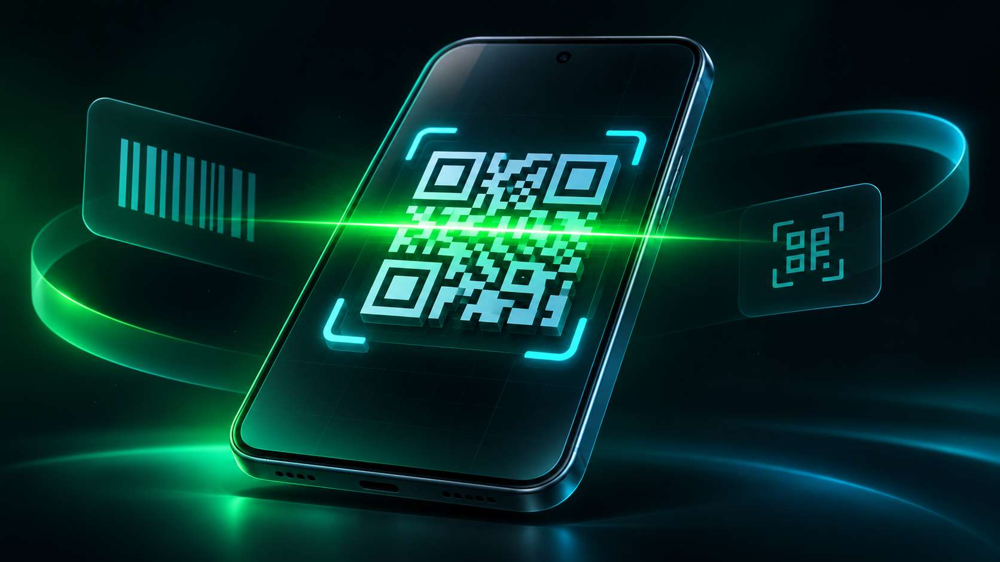

# Scanner Enhanced - Modern QR & Barcode Scanner

<p align="center">
  
</p>

[](https://www.android.com/)
[](https://kotlinlang.org/)
[](https://developer.android.com/jetpack/compose)
[](LICENSE)

Scanner Enhanced is a high-performance QR and barcode scanner for Android built with Jetpack Compose and CameraX. Inspired by Xiaomi Scanner, it combines dual-engine decoding (ML Kit with ZXing fallback), spring-driven viewfinder animations, smart payload parsing, and a low-memory dark UI.

---

## Features

- **Multi-Format Scanning**: Supports QR codes, 1D barcodes (EAN-13, UPC-A, Code 128, and more), PDF417, Data Matrix, and Aztec.
- **Dual-Engine Decoding**: Uses ML Kit Barcode Scanning as the primary decoder with ZXing Core fallback for inverted or damaged codes.
- **Gallery Import**: Decodes QR codes and barcodes from saved images using multi-pass processing.
- **Spring-Snap Scan Animation**: Responsive viewfinder with spring-snap framing, ripple burst, and confirmation checkmark on successful detection.
- **Smart Payload Parsing**: Automatically detects UPI payment links, Wi-Fi credentials, URLs, vCard/meCard contacts, and plain text.
- **Contextual Action Sheet**: One-tap actions to open URLs, connect to Wi-Fi, copy to clipboard, or share decoded content.
- **Persistent Scan History**: Stores scanned entries locally with swipe-to-delete management.
- **Flashlight Control**: Quick torch toggle directly from the camera viewfinder.
- **Low Memory Footprint**: Reusable buffers, capped analysis resolution, and R8 code/resource shrinking for release builds.

---

## Technical Stack

- **UI & Navigation**: 100% Jetpack Compose (BOM 2026.03.01) with Material 3 and Navigation3.
- **Camera & Decoding**: CameraX 1.4.2, ML Kit Barcode Scanning 17.3.0, and ZXing Core 3.5.3.
- **Persistence**: Local storage via `SharedPreferences`.
- **Compatibility**: Android 8.0+ (API 26+) with `compileSdk` 36 and `targetSdk` 36.

---

## Quick Start

### Build and Run

```bash
# Clone the repository
git clone https://github.com/gitadityakumar/scanner-enhanced.git
cd scanner-enhanced

# Run unit tests
./gradlew testDebugUnitTest

# Assemble debug APK
./gradlew assembleDebug

# Install and launch on connected device
./gradlew installDebug
adb shell am start -n com.scanner.enhanced/com.example.scanner.MainActivity
```

### Release Signing Setup

To generate a release keystore and upload the signing secrets (`KEYSTORE_BASE64`, `KEYSTORE_PASSWORD`, `KEY_ALIAS`, `KEY_PASSWORD`) to GitHub Actions using `gh`:

```bash
./scripts/setup-signing.sh
```

Push a version tag (e.g., `v1.0.0`) or trigger the **Release APK** workflow manually from GitHub Actions to build and publish a signed release APK.

## License

This project is licensed under the MIT License. See the [LICENSE](LICENSE) file for details.
